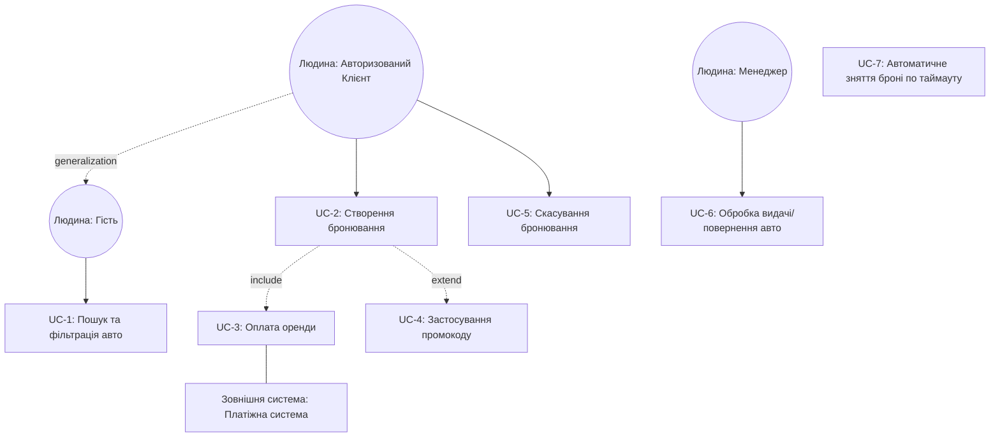

# Специфікація вимог та Use Case модель (Лабораторна робота №2)
## 1. Актори та цілі
1. **Клієнт (Client)**- людина. Мета: знайти авто, забронювати та керувати бронюваннями.
2. **Менеджер філії (Office Manager)**- людина. Мета: підтверджувати видачу/повернення авто.
3. **Платіжна система (Payment Gateway)**- зовнішня система. Мета: проводити транзакції.
## 2. Структуровані вимоги за EARS
* **REQ-01 (Ubiquitous):** Система SHALL буде забезпечувати перегляд доступного каталогу автомобілів без обов'язкової авторизації.
* **REQ-02 (Event-Driven):** WHEN клієнт обирає дату оренди та філію, система SHALL буде відображати лише вільні автомобілі для вказаного офісу.
* **REQ-03 (Event-Driven):** WHEN клієнт підтверджує бронювання, система SHALL буде ініціювати сесію оплати через платіжну систему.
* **REQ-04 (State-Driven):** WHILE клієнт перебуває в стані неоплаченого бронювання (протягом 15 хвилин), система SHALL буде тимчасово блокувати обраний автомобіль для інших користувачів.
* **REQ-05 (Optional Feature):** WHERE клієнт має промокод, система SHALL застосовувати знижку до підсумкової вартості `total_price`.
* **REQ-06 (Complex/Uncovered):** IF під час транзакції платіжна система не відповідає протягом 30 секунд, WHEN спливає таймаут, система SHALL скасовувати сесію та надсилати сповіщення клієнту про помилку еквайрингу.
## 3. User Stories та Gherkin-сценарії
### US-01: Бронювання авто клієнтом
*Як* Клієнт,  
*Я хочу* забронювати обраний автомобіль на конкретні дати у вибраній філії,  
*Щоб* зарезервувати авто для поїздки.
**Gherkin (Feature: Booking Car):**
```gherkin
Scenario: Успішне бронювання авто з проведенням оплати
  Given Клієнт авторизований у системі
  And автомобіль з `car_id` доступний у філії `office_id` на дати з "2026-11-01" по "2026-11-05"
  When Клієнт натискає "Забронювати" та підтверджує дані
  Then система створює запис `BOOKING` зі статусом "Pending"
  And система перенаправляє Клієнта до платіжної системи
  ```
### US-02: Застосування промокоду
*Як* Клієнт,  
*Я хочу* ввести промокод при оформленні,  
*Щоб* отримати знижку на оренду.
**Gherkin (Feature: Apply Promo Code):**
```gherkin
Scenario: Застосування дійсного промокоду
  Given Клієнт перебуває на екрані оплати бронювання
  When Клієнт вводить промокод "KPI2026"
  Then система перераховує `total_price` зі знижкою 10%
  And відображає оновлену суму до сплати
  ```
### US-03: Управління статусом авто менеджером
*Як* Менеджер філії,  
*Я хочу* відмічати авто як "Видане" або "Повернене",  
*Щоб* автопарк філії відображався актуально.
**Gherkin (Feature: Manage Car Status):**
```gherkin
Scenario: Прийняття авто після оренди
  Given Клієнт повернув авто у філію `office_id`
  When Менеджер філії обирає `booking_id` та натискає "Прийняти авто"
  Then система змінює статус `BOOKING` на "Completed"
  And статус автомобіля `CAR` змінюється на "Available"
  ```
## 4. Use Case діаграма (Mermaid)

## 5. Матриця трасування (N:M)
Матриця показує зв'язки «багато-до-багатьох» (N:M) між вимогами EARS та сценаріями/Use Cases, а також фіксує непокриті вимоги.
| Вимога ID | Назва вимоги (EARS) | Use Case ID | User Story ID | Покриття / Примітка |
| :--- | :--- | :--- | :--- | :--- |
| **REQ-01** | Перегляд каталогу без авторизації | UC-1 | US-01 | Покрито повністю |
| **REQ-02** | Фільтрація вільних авто за датами/офісом | UC-1, UC-2 | US-01 | Покрито (N:M) |
| **REQ-03** | Ініціація оплати при підтвердженні | UC-2, UC-3 | US-01 | Покрито (N:M) |
| **REQ-04** | Тимчасове блокування авто на 15 хв | UC-2, UC-7 | US-01 | Покрито (N:M) |
| **REQ-05** | Застосування промокоду | UC-4 | US-02 | Покрито повністю |
| **REQ-06** | Обробка таймауту еквайрингу (30 сек) | **Не закріплено** | **Немає** | **НЕПОКРИТА ВИМОГА** (Треба окремий фоновий воркер) |
| *—* | Прийняття та видача авто | UC-6 | US-03 | Сценарій без прямої EARS-вимоги (N:M) |